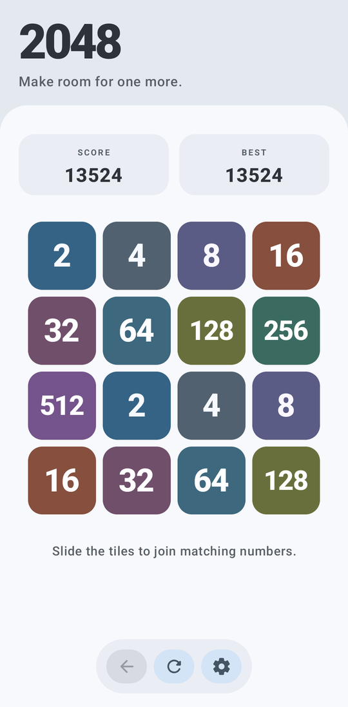
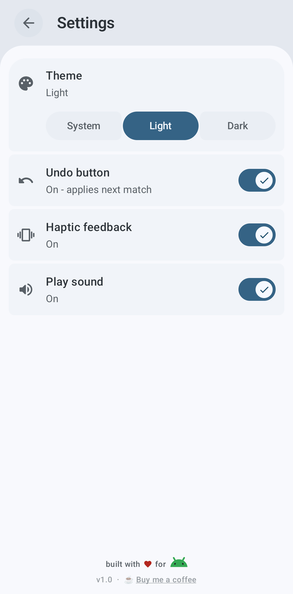
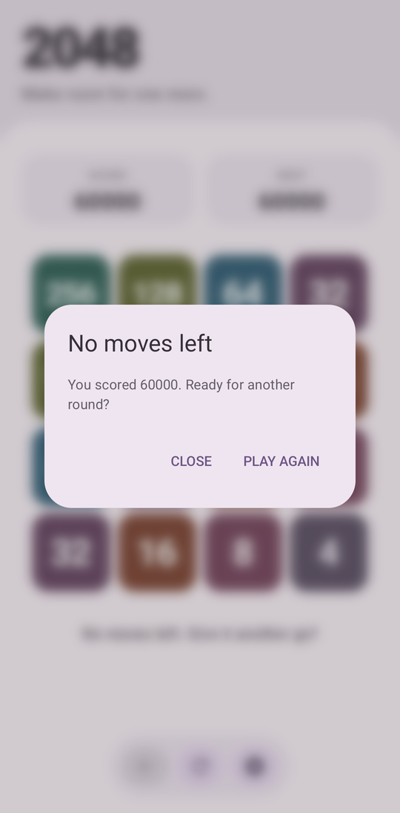
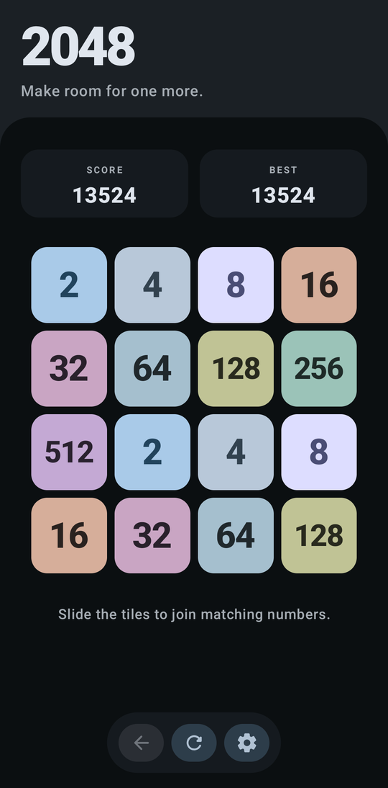
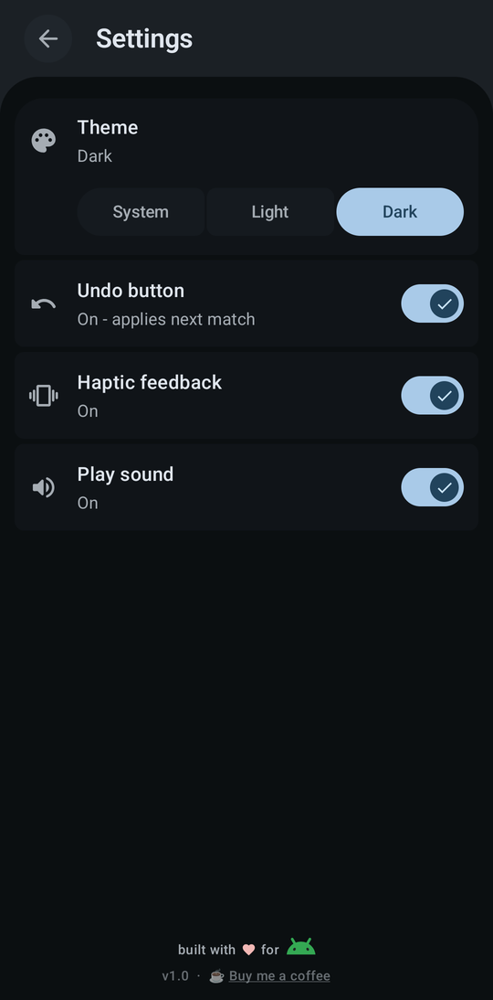
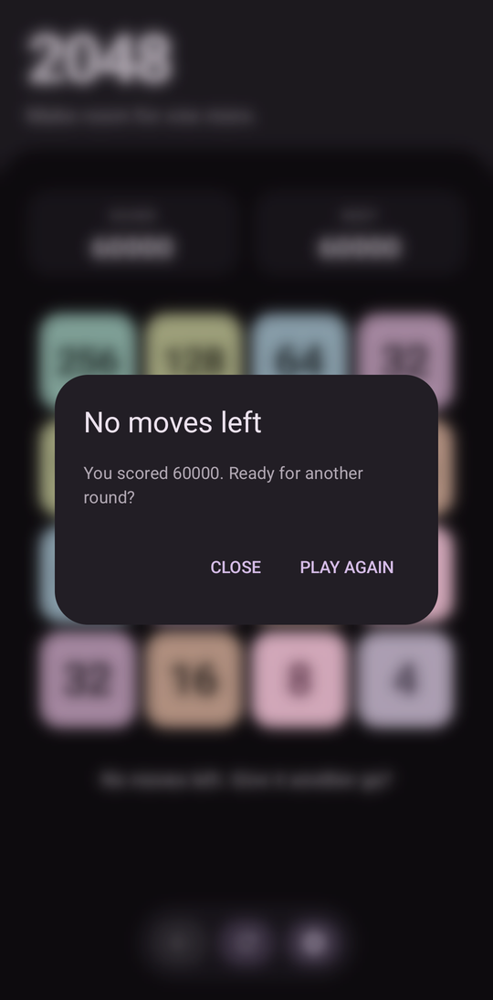

# Material 2048 for Android

A native Android 2048 game built with Kotlin, Jetpack Compose, and Material 3 Expressive. Low-value tiles use dynamic system accent roles; higher-value tiles use distinct, muted light/dark swatches. Tiles slide and merge with expressive spatial springs, and score changes get a quick count-up and subtle scale pop. Settings lets players choose system/light/dark themes and toggle haptic feedback.

The project uses the Compose alpha BOM to access Material 3's expressive motion APIs.

## Screenshots

| Game | Settings | Game over |
|:---:|:---:|:---:|
|  |  |  |
|  |  |  |

## Build

```sh
./gradlew assembleDebug
```

The APK is written to `app/build/outputs/apk/debug/app-debug.apk`.

## Play

Swipe in any direction to move the board. Use **Undo** to reverse the last move, or **New Game** to start over. The board, score, undo state, and best score persist across app restarts.

Run the game-logic tests with `./gradlew testDebugUnitTest`.
